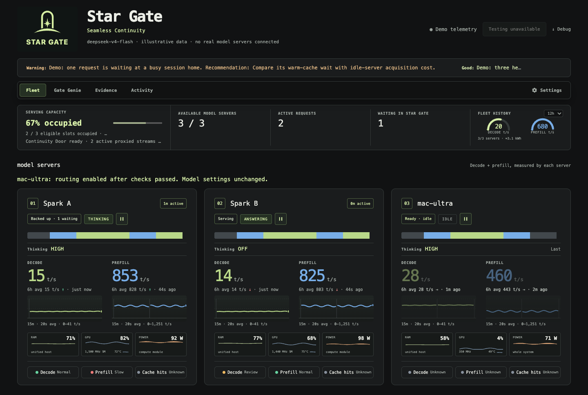
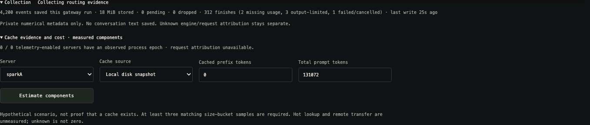
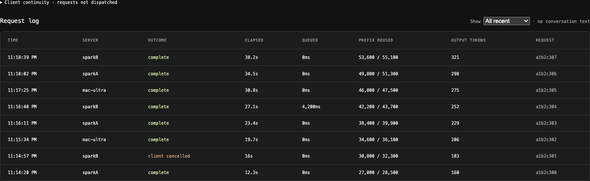
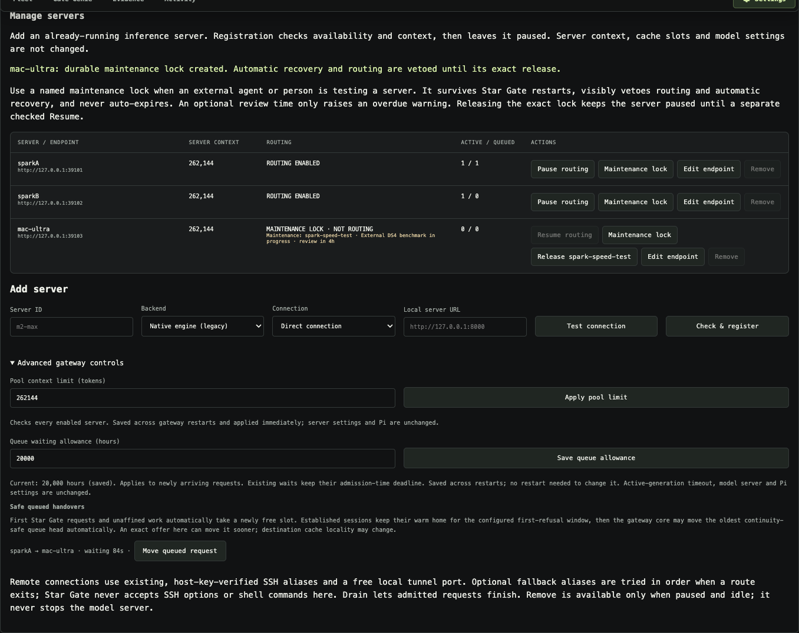

# Star Gate

**One stable endpoint for a local fleet of model servers.**

Star Gate (the repo and code still say **DSG**) is a small Node.js gateway that
sits in front of several OpenAI-compatible inference servers — DGX Sparks, Macs,
Linux boxes, or a mix — and gives your clients one address, one API key, and a
dashboard that explains what the fleet is doing.


[MIT licensed](LICENSE) · Created by [Jordi Posthumus](https://github.com/JordiPosthumus).

> **Status: early, single-maintainer, and honest about it.** This started as one
> person's home-fleet tool and is shared because it may be useful, not because it
> is production-hardened. Read [Caveats](#caveats) before you rely on it.

## What it does

- **One endpoint for many servers.** Clients talk to `http://127.0.0.1:30000/v1`;
  the gateway places each request on a registered backend.
- **Conversation affinity.** A stable session header keeps later turns on the
  same server so the engine's KV/prefix cache can be reused.
- **Queues that stay honest.** Per-server capacity, FIFO admission, explicit
  priority classes, ordered conversation turns, and a safe pre-dispatch handover
  when another server becomes free.
- **Continuity Door.** A tiny front proxy holds new requests while the gateway
  core is restarted, then forwards each held request exactly once. It makes
  planned gateway maintenance uneventful; it is not crash recovery.
- **A dashboard** (loopback only) with per-server speed, queue state, request
  history, quarantine state, optional hardware telemetry, and evidence views.
- **Scoped agent access.** A versioned local API plus `agents.sh` lets a coding
  agent drain a named server, do its work, and release only its own hold.
- **Opt-in recovery, media jobs, and hardware telemetry** for specific platforms
  (see [Feature status](#feature-status)).

## What it does not do

- It does not run models, ship weights, or patch your inference engine.
- It does not move KV caches between machines or promise cache hits.
- It does not replay requests after an ambiguous upstream failure.
- It is not a multi-tenant auth boundary, a scheduler for untrusted users, or a
  benchmark suite.
- It does not make a slow or broken backend fast. It makes the fleet legible.

## Caveats

These are the things a reader deserves to know before investing time:

1. **Single-operator origin.** The design assumes one trusted operator who owns
   the machines, the SSH keys, and the config. There is no user model, no roles,
   and no isolation between clients beyond the shared API key.
2. **Narrow real-world testing.** The gateway is exercised mainly against DS4
   (DwarfStar), vLLM, SGLang and oMLX on macOS and Linux. Other
   OpenAI-compatible servers are best-effort; provider quirks are common.
3. **Tests are fixtures, not benchmarks.** The suite drives local HTTP servers
   and temporary state. It proves protocol behavior, not throughput, GPU
   stability, or long-run soak. No benchmark numbers are published here.
4. **Hardware-specific features.** Recovery enrollment, hardware telemetry and
   media jobs target macOS LaunchAgents, systemd-user on DGX Spark, and specific
   engine APIs. They are opt-in and fail closed, but they are not universal.
5. **Genie is coming back, in stages.** The embedded assistant was removed in the
   gateway-only transition; his identity and brain contract are restored, but the
   first-party runtime and conversation tab are not shipped yet. Until they are,
   `/api/genie*` returns `410` and the Brain/Memory/Soul panels expect a Hermes
   runtime you install yourself. See [Genie](docs/genie.md) for the plan.
6. **Configuration is a JSON file, not a stable public API.** Field names have
   changed between revisions. Pin a commit if you need reproducibility.
7. **Documentation is uneven.** The `docs/` tree grew alongside the code. The
   README and `docs/simplified-system.md` are the best current map; older pages
   may describe retired features.
8. **No warranty.** MIT licensed, provided as-is. You are the operator.

## Requirements

- **Node.js 22.22.2+** (the gateway, door and dashboard use only the standard
  library; there is nothing to `npm install`).
- At least one reachable OpenAI-compatible model server.
- SSH access for remote workers (the gateway opens its own tunnels using your
  existing, host-key-verified aliases).
- macOS or Linux for the gateway host. The convenience service scripts are
  macOS-only; Linux uses systemd or foreground processes.

## Quick start

```sh
git clone https://github.com/JordiPosthumus/star-gate.git ~/DSG
cd ~/DSG
npm run setup -- --controls     # writes an ignored, mode-0600 config.local.json
npm run hooks:install           # optional: staged-file privacy + identity hook
npm run doctor                  # read-only checks; no inference, no SSH
npm start                       # gateway core
# in another terminal, same checkout:
npm run door                    # Continuity Door on :30000
# and a third:
npm run ui                      # dashboard on http://127.0.0.1:30010
```

Then open the dashboard, expand **Manage servers**, add an existing backend and
enable it after the compatibility check. Registration leaves a server **paused**
until you explicitly enable it.

No model server yet? The dashboard demo needs nothing else:

```sh
npm run ui:demo                 # synthetic fleet on http://127.0.0.1:30011
```

All screenshots below come from that demo, not from a real deployment.

## Gate Genie (optional)

Genie is Star Gate's resident agent. Install his private runtime and enable him
after the gateway works:

```sh
npm run genie:setup        # pinned Hermes, identity, brain config; starts nothing
npm run genie -- "how is the fleet?"   # one turn, from a terminal
```

He can use the gateway's own pool as his brain, or a dedicated endpoint, and can
commandeer an enrolled machine only when the fleet has no healthy worker and
nothing in flight. The gateway works exactly the same when he is absent. See
[Genie](docs/genie.md) for the authority model and the full brain ladder.



<details>
<summary>More synthetic views: Genie-era panels, evidence, activity, server management</summary>







</details>

## How it fits together

```text
client ──▶ Continuity Door (:30000) ──▶ Gateway core (:30001) ──▶ model servers
                                          │
                                          ├─ private Unix socket ── operator CLI / agent API
                                          └─ dashboard (:30010) ── loopback, read-only by default
```

Three long-running Node processes:

| Process | Entry point | Job |
| --- | --- | --- |
| Gateway core | `ds4-gateway/gateway.mjs` | Admission, affinity, queues, routing, health, quarantine, control socket |
| Continuity Door | `ds4-gateway/door.mjs` | Stable client port; holds requests across a core restart |
| Dashboard | `ds4-gateway/dashboard.mjs` | Local UI and JSON views; no inference calls of its own |

The operator surface is a private Unix socket, never a LAN admin port. The
dashboard binds loopback and validates `Host`/`Origin`; server-management
controls are off unless you set `ui_worker_management: true`.

## Feature status

| Area | State | Notes |
| --- | --- | --- |
| Request forwarding, SSE passthrough, affinity | Stable | The core path; fixtures cover byte preservation and cancellation |
| Queueing, priority, conversation turns, handover | Stable | Explicit policy; no automatic replay |
| Continuity Door | Stable | Planned-restart continuity only |
| Dashboard + evidence views | Stable | Read-only by default |
| Agent API (`agents.sh`) | Stable | Scoped drains; local-account trust boundary |
| Routing v2 measurement guards | New / experimental | Rejects implausible lane speeds; off unless `routing_v2_enabled` |
| Generation quarantine + verified readmission | Stable | Requires a real generation check to return |
| Service recovery (systemd-user / launchd) | Opt-in | Per-machine enrollment and canary required |
| Hardware telemetry (RAM/GPU/power/temp) | Opt-in | DGX Spark SSH/NVIDIA adapter or local JSONL |
| Media jobs (H3 / ACE-Step) | Experimental | Hardware- and recipe-specific |
| LAN sharing + Pi client sync | Opt-in | Advertises a fixed home-LAN key `none` |
| Gate Genie (agent + Hermes runtime) | **Restoring** | Runtime, identity, conversation and a read-only fleet tool are in; Genie tab, action tools and messaging next. See [Genie](docs/genie.md) |

## Configuration and private files

Everything private lives beside the checkout and is git-ignored:

```text
DSG/
  ds4-gateway/       source
  scripts/           setup, doctor, checks
  docs/              documentation
  config.local.json  PRIVATE: key, endpoints, policy (mode 0600)
  runtime/           PRIVATE: affinity state, sockets, logs, evidence
```

`config.local.json` is selected by, in order: an explicit CLI argument,
`DWARF_GATE_CONFIG`, then `./config.local.json`. Relative local paths inside it
resolve against the config file's directory. See
[installation and private runtime](docs/installation.md) for the full contract.

Never commit `config.local.json`, `runtime/`, credentials, logs, model files, or
machine-specific notes. The repository's privacy hook checks staged blobs, but
it is a guardrail, not a proof.

## Security model

Read [SECURITY.md](SECURITY.md) and [docs/publication-policy.md](docs/publication-policy.md).

- Trusted operator, single inference key. Not multi-tenant.
- Loopback by default. Exposing the inference port beyond loopback needs your own
  authentication, TLS and network boundary.
- The dashboard is loopback-only and must not be reverse-proxied publicly.
- The operator socket is local-account authority. A scoped agent credential is an
  accident-prevention and attribution boundary, not a sandbox.
- Diagnostics are sanitized but still sensitive; review before sharing.

## Documentation

Start here:

- [Simplified system overview](docs/simplified-system.md) — what each part does.
- [Gate Genie](docs/genie.md) — identity, brain ladder, authority, messaging.
- [Installation and private runtime](docs/installation.md) — config, paths, services.
- [New backend onboarding](docs/server-setup-guide.md) — add an engine.
- [OpenAI-compatible workers](docs/openai-endpoints.md) — non-DS4 backends.
- [Continuity Door contract](docs/continuity-door.md) — exactly what is held.
- [Queued handover](docs/queued-handover.md) — when work may move.
- [Client continuity](docs/client-continuity.md) — waiting, errors, no replay.
- [Agent API](docs/agent-api.md) and [Agent Watch](docs/agent-watch.md).
- [Worker recovery](docs/worker-recovery.md) — opt-in, guarded.
- [Hardware telemetry](docs/hardware-telemetry.md) — opt-in adapters.
- [Media jobs](docs/media-jobs.md) — experimental.
- [Roadmap](docs/roadmap.md) — direction, not promises.
- [Screenshots](docs/screenshots.md) — how the demo images are produced.

Platform notes: [Qwen Spark profile](docs/qwen-spark-profile.md),
[oMLX recovery](docs/omlx-recovery.md), [Docker recovery](docs/docker-recovery.md),
[LAN sharing](docs/lan-sharing.md), [Pi integration](docs/pi-integration-plan.md).

## For AI agents

See [AGENTS.md](AGENTS.md) for a compact orientation: commands, repo map,
invariants, test procedure, and the rules that keep private data out of Git.
Two machine-oriented entry points also exist:

- `docs/agent-machine-setup.md` — provision a new machine and register it.
- `docs/agent-recovery-enrollment.md` — enroll one service for guarded recovery.
- `agents.sh` — scoped drain/resume client for an existing fleet.

## Development

```sh
npm run check          # syntax-check every .mjs and shell script
npm test               # main Node test suite (local fixtures)
npm run continuity:test
npm run data:test
npm run recovery:test  # also runs the optional Python adapters
npm run privacy-check  # tracked + working-copy privacy guard
npm run privacy:test
```

The suite needs no network, no GPU and no real model server. CI runs it on Linux
and macOS. If you change behavior, add a fixture-based regression test; if you
change a guarantee or a limitation, update this README.

Contributions: read [CONTRIBUTING.md](CONTRIBUTING.md). Keep the privacy rules in
[docs/publication-policy.md](docs/publication-policy.md).

## Credits

Star Gate coordinates engines; it does not replace them. It began around
[DwarfStar / DS4](https://github.com/antirez/ds4) by
[Salvatore “antirez” Sanfilippo](https://github.com/antirez) and its contributors,
and supports other OpenAI-compatible backends. Engine and model projects keep
their own licenses and authorship. See [CREDITS.md](CREDITS.md).

## License

[MIT](LICENSE) © 2026 Jordi Posthumus. Model weights, engine binaries and
upstream projects are licensed separately; this repository's license does not
replace their terms.
